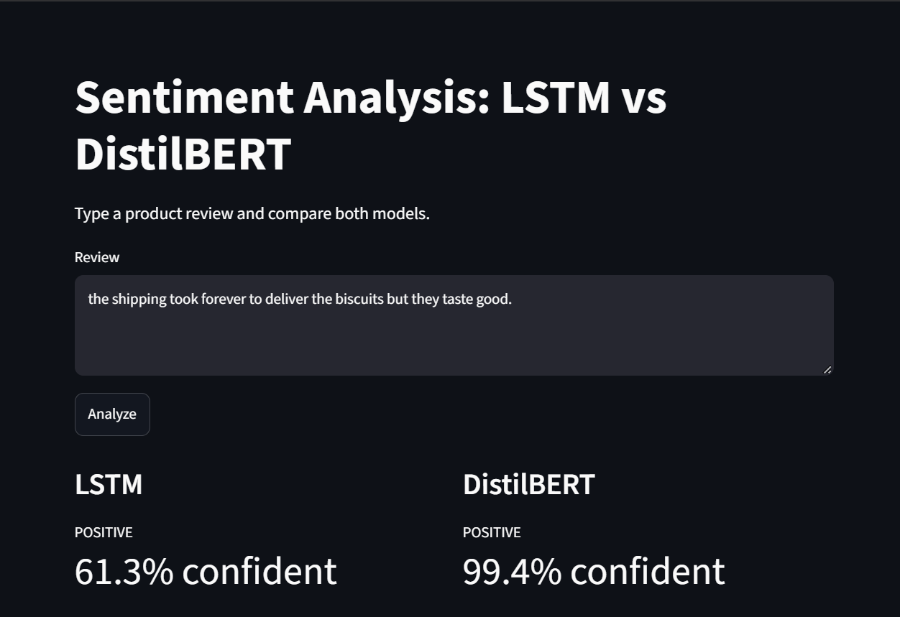
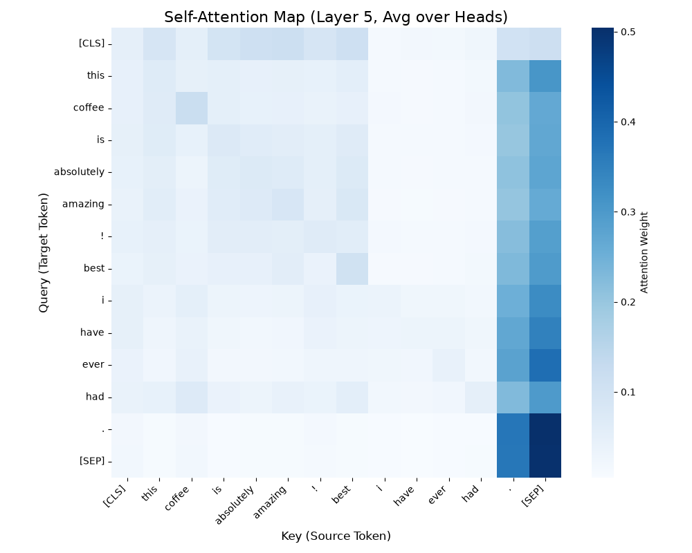

# Sentiment Analysis on Amazon Reviews: LSTM vs DistilBERT


A side-by-side comparison of two approaches to sentiment classification: an **LSTM trained from scratch** and a **fine-tuned DistilBERT**, evaluated on 20,000 Amazon Fine Food reviews. The project also includes **attention heatmaps** to show which words DistilBERT focuses on, and an **interactive Streamlit app** to try both models on your own text.

## Demo



*Type any product review and see both models' predictions and confidence side by side.*

## Results

| Model      | Accuracy | F1 (macro) |
|------------|----------|------------|
| LSTM       | 87.05%   | 0.8705     |
| DistilBERT | **92.55%** | **0.9255** |

Evaluated on a held-out test set of 4,000 reviews (2,000 per class). DistilBERT beats the LSTM by about 5.5 points. It starts with pre-trained knowledge of language, while the LSTM has to learn language from only 16,000 training reviews.

Accuracy and F1 are nearly identical because the dataset was balanced on purpose (see below).

## Attention Visualization



*Self-attention heatmap from DistilBERT's last layer, averaged across attention heads. Each cell shows how much one token (row) attends to another (column). Heatmaps for all 6 layers are in `results/`.*

## Dataset

[Amazon Fine Food Reviews](https://www.kaggle.com/datasets/snap/amazon-fine-food-reviews) from Kaggle (about 500K reviews).

- **Labels:** 1-2 stars → negative, 4-5 stars → positive. 3-star (neutral) reviews are removed.
- **Class imbalance:** the raw data is roughly 80% positive. A model could score about 80% just by always guessing "positive", so I sampled **10,000 reviews per class** (20,000 total).
- **Split:** 80/20 stratified train/test (16,000 train, 4,000 test).

## Methodology

**Preprocessing:** lowercasing, HTML tag removal, whitespace cleanup, duplicate removal.

**LSTM (PyTorch)**
- Word-level vocabulary built from the **training set only**, to avoid data leakage
- Embedding layer (128-dim) → 2-layer LSTM (128 hidden units, dropout 0.3) → linear layer with 2 outputs
- Pre-padding to 200 tokens, so the final LSTM step always sees real words
- Adam optimizer (lr 1e-3), gradient clipping, batch size 32, 5 epochs

**DistilBERT (Hugging Face)**
- `distilbert-base-uncased` fine-tuned with the `Trainer` API
- Max length 128 tokens, lr 2e-5, weight decay 0.01, batch size 16, 2 epochs

**Interpretability:** per-layer self-attention maps, averaged over heads.

Final results were trained on a Google Colab T4 GPU.

## Project Structure

```
├── src/
│   ├── main.py          # trains and evaluates both models, saves results and models
│   ├── model.py         # LSTM architecture, dataset wrapper, DistilBERT loader
│   └── utils.py         # data loading, cleaning, vocab, metrics, attention plots
├── demo/
│   └── demo.ipynb       # loads trained models and predicts on sample reviews
├── results/             # metrics, demo predictions, attention heatmaps
├── images/              # screenshots used in this README
├── app.py               # Streamlit demo app
├── requirements.txt
└── README.md
```

## How to Run

**1. Install dependencies**
```bash
pip install -r requirements.txt
```
Download the NLTK tokenizer data once:
```python
import nltk
nltk.download("punkt")
nltk.download("punkt_tab")
```

**2. Get the data**
Download `Reviews.csv` from the [Kaggle dataset](https://www.kaggle.com/datasets/snap/amazon-fine-food-reviews) and place it at `data/Reviews.csv`.

**3. Train and evaluate**
```bash
python src/main.py
```
In `src/main.py`, `N_PER_CLASS` sets the sample size per class. Use `500` for a quick test run, and `10000` to reproduce the results above. A GPU is strongly recommended for the full run, since DistilBERT is slow on CPU. This creates the `results/` files and saves the trained models to `models/`.

**4. Try the demo**
```bash
python -m streamlit run app.py
```
or open `demo/demo.ipynb` in Jupyter.

Trained model weights are not included in the repo because of file size, so run step 3 first to generate them.

## Limitations

- One dataset (food reviews) and a single train/test split, so results may differ on other product categories
- Binary labels only; neutral reviews are excluded
- Star ratings are used as a proxy for sentiment, so some labels are noisy (for example, a 4-star review that complains about shipping)
- Mixed-sentiment reviews ("great taste but arrived damaged") are the hardest cases for both models

## Acknowledgments

This project references the following resources:

* **Data Preprocessing Strategy:** Adapted from the Kaggle notebook by kfrawee. Source: [Sentimental Analysis on Kaggle](https://www.kaggle.com/code/kfrawee/sentimental-analysis)
* **LSTM Model Architecture:** Inspired by the Amazon Sentiment analysis project by iamirmasoud. Source: [Amazon Sentiment GitHub Repository](https://github.com/iamirmasoud/amazon_sentiment/tree/main)
* **Transformer Model:** Utilizes DistilBERT from [Hugging Face Transformers](https://huggingface.co/distilbert-base-uncased). Dataset: [Amazon Fine Food Reviews](https://www.kaggle.com/datasets/snap/amazon-fine-food-reviews) provided by Stanford Network Analysis Project (SNAP) on Kaggle.
